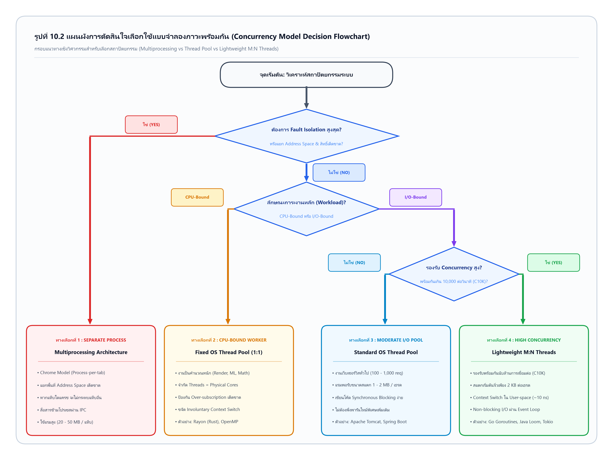

# ต้นฉบับรายงานวิชา Operating Systems (OS) สำหรับเขียนด้วยลายมือลงกระดาษ A4 มีเส้น
## ส่วนที่ 3: บทที่ 7 ถึง บทที่ 10 (หน้าที่ 55 ถึง หน้าที่ 81)
### หัวข้อ: Thread & Multithreading ในระบบปฏิบัติการสมัยใหม่

---

<!-- ========================================================================== -->
<!-- หน้าที่ 55                                                                 -->
<!-- ========================================================================== -->
### [หน้าที่ 55 ของรายงาน]
*(เริ่มหน้าใหม่ แผ่นที่ 55)*

**บทที่ 7: กลไกขั้นสูงในการจัดการเธรดระดับระบบปฏิบัติการ (Advanced Threading Mechanics)**  
*(เว้น 1 บรรทัด)*  
**7.1 พฤติกรรมของ System Call `fork()` และ `exec()` ในระบบมัลติเธรด**  

[ย่อหน้า 1.5 ซม.] ในระบบปฏิบัติการตระกูล UNIX และ Linux ความสัมพันธ์ระหว่างซิสเต็มคอลดั้งเดิมอย่าง `fork()` และ `exec()` กับสถาปัตยกรรมมัลติเธรด เป็นหนึ่งในประเด็นที่ก่อให้เกิดความสับสนและข้อผิดพลาดร้ายแรงที่สุดในเชิงวิศวกรรมระบบ [Love, 2010]

[ย่อหน้า 1.5 ซม.] **คำถามทางสถาปัตยกรรม:**  
> *“หากโพรเซสหนึ่งมี 10 เธรดทำงานอยู่พร้อมกัน แล้วมีเธรดหนึ่งเรียกใช้คำสั่ง `fork()` โพรเซสลูก (Child Process) ที่กำเนิดขึ้นมาใหม่ ควรจะมีเธรดกี่ตัว?”*

[ย่อหน้า 1.5 ซม.] **1. ข้อกำหนดตามมาตรฐาน POSIX (POSIX Specification & Modern Linux):**  
ในอดีต ระบบปฏิบัติการรุ่นเก่าบางตัว (เช่น Solaris ยุคแรก) เคยพยายามนำเสนอสองทางเลือก ได้แก่ `forkall()` (คัดลอกทุกเธรดตามไปด้วย) และ `fork1()` (คัดลอกเฉพาะเธรดที่เรียก) อย่างไรก็ตาม ในมาตรฐานสากล **POSIX.1c (IEEE Std 1003.1)** และระบบปฏิบัติการ Linux สมัยใหม่ทั้งหมด ได้ตัดสินใจอย่างเด็ดขาดว่า [IEEE, 1995]:  
> **“เมื่อเธรดใดเธรดหนึ่งในโพรเซสแบบมัลติเธรดเรียกใช้ `fork()` โพรเซสลูกที่ถูกสร้างขึ้นมาจะมีเพียง 'เธรดเดียวเท่านั้น' (Single-threaded Child) คือเธรดที่ทำหน้าที่เรียกคำสั่ง `fork()` ส่วนเธรดอื่นที่เหลือทั้งหมดจะสูญสลายหายไป ไม่ถูกคัดลอกมายังโพรเซสลูก”**

*(เว้น 1 บรรทัด)*  
**อันตรายระดับวิกฤติ: ภาวะ Deadlock ในโพรเซสลูก (The Fork-Safety Hazard)**  
[ย่อหน้า 1.5 ซม.] ผลสืบเนื่องจากกฎของ POSIX ข้อนี้ก่อให้เกิดปัญหาความปลอดภัยร้ายแรง หากในขณะที่เธรด A กำลังเรียก `fork()` อยู่นั้น เธรด B (ซึ่งกำลังทำงานอยู่บนอีกคอร์หนึ่ง) ได้เข้าถือครอง Mutex Lock ของหน่วยความจำส่วนกลางอยู่ เมื่อเคอร์เนลสร้างโพรเซสลูกขึ้นมา:  
* โพรเซสลูกจะได้รับสำเนาหน่วยความจำของโพรเซสแม่มาทั้งหมด รวมถึงสถานะของ Mutex Lock ตัวนั้นซึ่งยังคงอยู่ในสถานะ **"Locked"**  
* แต่โพรเซสลูกกลับ **"ไม่มีเธรด B ติดตามมาด้วย!"**  
* ผลลัพธ์คือ: Mutex ในโพรเซสลูกจะอยู่ในสถานะถูกล็อกค้างไว้ตลอดกาล โดยไม่มีเธรดใดในโลกที่มีสิทธิ์ปลดล็อกได้ หากเธรดเดี่ยวในโพรเซสลูกพยายามเข้าขอล็อกนี้ โพรเซสลูกจะเกิดภาวะ **Deadlock ถาวรในทันที** [Butenhof, 1997]

---

<!-- ========================================================================== -->
<!-- หน้าที่ 56                                                                 -->
<!-- ========================================================================== -->
### [หน้าที่ 56 ของรายงาน]
*(ต่อเนื้อหาจากหน้า 55)*

**แนวทางแก้ไขทางวิศวกรรม: กลไก `pthread_atfork()`**  

[ย่อหน้า 1.5 ซม.] เพื่อแก้ไขปัญหา Mutex Deadlock จากการ `fork()` มาตรฐาน POSIX ได้กำหนดฟังก์ชันการลงทะเบียนจุดตรวจจับล่วงหน้า เรียกว่า `pthread_atfork()` [IEEE, 1995]:
```c
int pthread_atfork(void (*prepare)(void), void (*parent)(void), void (*child)(void));
```
ฟังก์ชันนี้ทำงานโดยกำหนดจุดเชื่อมต่อ (Hooks) 3 ขั้นตอน [Butenhof, 1997]:  
1. **`prepare` Handler:** ถูกเรียกทำงานในโพรเซสแม่ *ก่อนที่* `fork()` จะเริ่มดำเนินการ ทำหน้าที่สั่งให้โพรเซสแม่เข้าล็อก Mutex ทุกตัวในระบบให้หมด เพื่อหยุดการทำงานของเธรดอื่นไม่ให้แก้ไขข้อมูล  
2. **`parent` Handler:** ถูกเรียกทำงานในโพรเซสแม่ *หลังจากที่* `fork()` สร้างลูกเสร็จสิ้น ทำหน้าที่ปลดล็อก Mutex ทั้งหมดในโพรเซสแม่ เพื่อให้เธรดอื่นทำงานต่อได้ตามปกติ  
3. **`child` Handler:** ถูกเรียกทำงานในโพรเซสลูก *ทันทีหลังการเกิด* ทำหน้าที่รีเซ็ตและปลดล็อก Mutex ทั้งหมดในโพรเซสลูก ทำให้โพรเซสลูกเริ่มต้นด้วยสถานะล็อกที่ว่างเปล่าอย่างปลอดภัย [Love, 2010]

*(เว้น 1 บรรทัด)*  
**พฤติกรรมเมื่อเรียกใช้คำสั่ง `exec()`:**  
[ย่อหน้า 1.5 ซม.] ตรงกันข้ามกับ `fork()` เมื่อเธรดใดเธรดหนึ่งในโพรเซสเรียกใช้กลุ่มฟังก์ชัน `exec()` (เช่น `execve()`):  
* เคอร์เนลจะทำการ **"ทำลายล้าง Address Space เดิมทิ้งทั้งหมด"** และโหลดโปรแกรมไบนารีตัวใหม่เข้ามาแทนที่ในหน่วยความจำ  
* เธรดอื่นทั้งหมดในโพรเซสเดิมจะถูกเคอร์เนลยุติการทำงานและทำลายทิ้งทันที โดยไม่มีการเรียก Cleanup Handlers ใดๆ  
* โพรเซสใหม่ที่เกิดขึ้นจะเริ่มต้นทำงานใหม่ตั้งแต่ฟังก์ชัน `main()` ด้วยการเป็นโพรเซสแบบ **เธรดเดี่ยว (Single-threaded)** เสมอ [Silberschatz et al., 2018]

---

<!-- ========================================================================== -->
<!-- หน้าที่ 57                                                                 -->
<!-- ========================================================================== -->
### [หน้าที่ 57 ของรายงาน]
*(ต่อเนื้อหาจากหน้า 56)*

**7.2 การยกเลิกเธรด (Thread Cancellation)**  

[ย่อหน้า 1.5 ซม.] การยกเลิกเธรด (Thread Cancellation) คือกลไกที่เธรดหนึ่งส่งสัญญาณคำสั่งเพื่อสั่งยุติการทำงานของเธรดเป้าหมาย (Target Thread) ก่อนที่เธรดเป้าหมายนั้นจะทำงานจบฟังก์ชัน ตัวอย่างเช่น เมื่อผู้ใช้คลิกปุ่ม "ยกเลิก" การดาวน์โหลดไฟล์ หรือเมื่ออัลกอริทึมค้นหาแบบขนาน (Parallel Search) มีเธรดหนึ่งค้นพบคำตอบแล้ว จึงต้องการสั่งหยุดเธรดที่เหลือทั้งหมด [Silberschatz et al., 2018]

[ย่อหน้า 1.5 ซม.] มาตรฐาน POSIX Threads กำหนดรูปแบบการยกเลิกไว้ 2 รูปแบบที่มีความเสี่ยงทางวิศวกรรมแตกต่างกันอย่างสิ้นเชิง [Butenhof, 1997]:

[ย่อหน้า 1.5 ซม.] **1. การยกเลิกแบบอะซิงโครนัส (Asynchronous Cancellation):**  
ในโหมดนี้ เมื่อเธรดเป้าหมายได้รับสัญญาณยกเลิก ระบบปฏิบัติการจะสั่ง **"ตัดจบและทำลายเธรดเป้าหมายทิ้งในเสี้ยววินาทีนั้นทันที"** โดยไม่สนใจว่าเธรดกำลังประมวลผลคำสั่งใดอยู่  
* **ความเสี่ยงร้ายแรง:** เป็นโหมดที่อันตรายที่สุดและมีข้อห้ามใช้ในงานระดับองค์กร หากเธรดเป้าหมายถูกฆ่าทิ้งในขณะที่กำลังถือครอง Mutex Lock หรืออยู่ระหว่างการจัดสรรหน่วยความจำ `malloc()` ทรัพยากรเหล่านั้นจะค้างอยู่ในระบบอย่างถาวร นำไปสู่ปัญหา Memory Leak ร้ายแรง และทำให้เธรดอื่นที่รอคอยล็อกตัวนั้นเกิด Deadlock ทันที [Love, 2010]

[ย่อหน้า 1.5 ซม.] **2. การยกเลิกแบบหน่วงเวลา (Deferred Cancellation - รูปแบบมาตรฐาน):**  
ในโหมดนี้ เมื่อได้รับสัญญาณยกเลิก เธรดจะไม่ถูกฆ่าทิ้งทันที แต่สัญญาณจะถูกตั้งเป็นแฟล็ก Pending ไว้ เธรดเป้าหมายจะยังคงทำงานต่อไปได้อย่างปลอดภัย จนกว่าการทำงานจะเดินทางมาถึงจุดตรวจสอบที่ปลอดภัย เรียกว่า **"จุดตรวจสอบการยกเลิก" (Cancellation Points)** [Silberschatz et al., 2018]  
* จุด Cancellation Points ตามมาตรฐาน POSIX ได้แก่ ฟังก์ชันบล็อกกิ้งระดับระบบ เช่น `read()`, `write()`, `open()`, `sleep()`, หรือการสั่งตรวจสอบด้วยตนเองผ่านฟังก์ชัน `pthread_testcancel()` โหมดนี้เปิดโอกาสให้โปรแกรมเมอร์มั่นใจได้ว่าข้อมูลจะไม่เสียหายก่อนถูกยกเลิก [IEEE, 1995]

---

<!-- ========================================================================== -->
<!-- หน้าที่ 58                                                                 -->
<!-- ========================================================================== -->
### [หน้าที่ 58 ของรายงาน]
*(ต่อเนื้อหาจากหน้า 57)*

**กลไกตัวจัดการทำความสะอาดทรัพยากร (Thread Cleanup Handlers)**  

[ย่อหน้า 1.5 ซม.] เพื่อแก้ไขปัญหา Resource Leak เมื่อเธรดถูกยกเลิกแบบ Deferred มาตรฐาน POSIX ได้ออกแบบกลไก "ตัวจัดการทำความสะอาด" (Cleanup Handlers) ซึ่งทำงานในลักษณะสแตก (LIFO Stack) ผ่านคู่ฟังก์ชัน [Butenhof, 1997]:
```c
pthread_cleanup_push(void (*routine)(void *), void *arg);
pthread_cleanup_pop(int execute);
```

[ย่อหน้า 1.5 ซม.] **หลักการทำงาน:**  
เมื่อเธรดได้รับการจัดสรรทรัพยากรสำคัญ (เช่น จองหน่วยความจำหรือเข้ายึด Mutex) เธรดจะทำการลงทะเบียนฟังก์ชันทำความสะอาดไว้บนสแตกด้วย `pthread_cleanup_push()` หากเธรดถูกสั่งยกเลิก (Cancelled) ณ จุด Cancellation Point ใดๆ ระบบปฏิบัติการจะดำเนินการดึงฟังก์ชันทำความสะอาดออกจากสแตกมาประมวลผลโดยอัตโนมัติ เพื่อสั่งปลดล็อก Mutex และคืนพื้นที่หน่วยความจำทิ้งอย่างปลอดภัย ก่อนที่เธรดจะสิ้นสุดสภาพลงอย่างสมบูรณ์ [IEEE, 1995]

*(เว้น 1 บรรทัด)*  
**ตัวอย่างการประยุกต์ใช้เพื่อความปลอดภัย:**
```c
void unlock_mutex(void *arg) {
    pthread_mutex_unlock((pthread_mutex_t *)arg);
}

void* worker(void* arg) {
    pthread_mutex_lock(&lock);
    pthread_cleanup_push(unlock_mutex, (void *)&lock); // บันทึก Handler

    while (1) {
        // ประมวลผลคำสั่ง...
        pthread_testcancel(); // จุดตรวจสอบ: หากถูกยกเลิก จะเรียก unlock_mutex อัตโนมัติ
    }

    pthread_cleanup_pop(1); // นำออกจากสแตกและสั่งรันปกติเมื่อจบ
    return NULL;
}
```
*(คำอธิบาย: การใช้ Cleanup Handlers รับประกันว่า Mutex จะไม่มีวันถูกล็อกค้างไว้ แม้เธรดจะถูกสั่งหยุดกะทันหัน)*

---

<!-- ========================================================================== -->
<!-- หน้าที่ 59                                                                 -->
<!-- ========================================================================== -->
### [หน้าที่ 59 ของรายงาน]
*(ต่อเนื้อหาจากหน้า 58)*

**7.3 การจัดการสัญญาณในระบบมัลติเธรด (Signal Handling in Multithreaded Systems)**  

[ย่อหน้า 1.5 ซม.] สัญญาณ (Signals) คือกลไกการแจ้งเตือนเหตุการณ์แบบอะซิงโครนัสในระบบปฏิบัติการตระกูล UNIX (เช่น สัญญาณการละเมิดหน่วยความจำ `SIGSEGV`, สัญญาณการหารด้วยศูนย์ `SIGFPE`, หรือสัญญาณขัดจังหวะจากผู้ใช้ `SIGINT`) ในสถาปัตยกรรมโพรเซสเดี่ยว การจัดการสัญญาณเป็นเรื่องตรงไปตรงมา แต่เมื่อระบบมีหลายเธรดทำงานพร้อมกัน จะเกิดคำถามทางสถาปัตยกรรมว่า:  
> *“เมื่อสัญญาณถูกส่งเข้ามายังโพรเซส ระบบปฏิบัติการควรส่งสัญญาณนั้นไปให้เธรดตัวใดเป็นผู้จัดการ?”* [Love, 2010]

[ย่อหน้า 1.5 ซม.] ระบบปฏิบัติการสมัยใหม่จำแนกการส่งสัญญาณออกเป็น 2 รูปแบบตามแหล่งกำเนิด [Silberschatz et al., 2018]:

[ย่อหน้า 1.5 ซม.] **1. สัญญาณแบบซิงโครนัส (Synchronous Signals):**  
เป็นสัญญาณที่เกิดขึ้นจากการกระทำโดยตรงของคำสั่งภายในเธรดนั้นๆ เช่น การเข้าถึงหน่วยความจำที่ผิดกฎหมาย (`SIGSEGV`) หรือการหารตัวเลขด้วยศูนย์ (`SIGFPE`)  
* **กฎการส่ง:** เคอร์เนลจะดำเนินการ **"ส่งสัญญาณตรงไปยังเธรดที่เป็นผู้ก่อให้เกิดข้อผิดพลาดนั้นแต่เพียงผู้เดียว"** (Delivered to the causing thread) และเธรดนั้นจะต้องเป็นผู้จัดการ [Love, 2010]

[ย่อหน้า 1.5 ซม.] **2. สัญญาณแบบอะซิงโครนัส (Asynchronous Signals):**  
เป็นสัญญาณที่ถูกสร้างขึ้นจากเหตุการณ์ภายนอกโพรเซส เช่น ผู้ใช้กดปุ่ม `Ctrl+C` บนคีย์บอร์ด (`SIGINT`), สัญญาณจับเวลา (`SIGALRM`), หรือสัญญาณสั่งยุติการทำงานจากภายนอก (`SIGTERM`)  
* **กฎการส่ง:** สัญญาณเหล่านี้ถูกส่งมายัง "ระดับโพรเซสโดยรวม" เคอร์เนลของระบบปฏิบัติการมีทางเลือก 3 ทาง: (1) ส่งสัญญาณให้แก่เธรดแรกในโพรเซสที่ไม่ได้ปิดกั้นสัญญาณนั้น, (2) สุ่มส่งให้แก่เธรดใดเธรดหนึ่งที่พร้อมทำงาน, หรือ (3) ส่งให้แก่เธรดทุกตัวในโพรเซส (ซึ่งสิ้นเปลืองอย่างยิ่ง) [Love, 2010]

---

<!-- ========================================================================== -->
<!-- หน้าที่ 60                                                                 -->
<!-- ========================================================================== -->
### [หน้าที่ 60 ของรายงาน]
*(ต่อเนื้อหาจากหน้า 59)*

**แนวทางปฏิบัติทางวิศวกรรม: การใช้ Dedicated Signal Handling Thread**  

[ย่อหน้า 1.5 ซม.] ในทางวิศวกรรมซอฟต์แวร์ระบบ การปล่อยให้สัญญาณอะซิงโครนัสกระโดดไปขัดจังหวะเธรดทำงานใดๆ แบบสุ่ม ก่อให้เกิดความเสี่ยงสูงมากเรื่อง Race Condition และ Reentrancy Bugs (ฟังก์ชันจัดการสัญญาณจำนวนมากไม่ปลอดภัยสำหรับการทำงานแบบ Concurrency หรือ Non-reentrant) [Love, 2010]

[ย่อหน้า 1.5 ซม.] มาตรฐาน POSIX จึงแนะนำแนวทางปฏิบัติที่ดีที่สุด (Best Practice) ด้วยการใช้สถาปัตยกรรม **"เธรดจัดการสัญญาณเฉพาะกิจ" (Dedicated Signal Handling Thread)** [Butenhof, 1997]:  
1. เธรดทั้งหมดในโพรเซสจะทำการปิดกั้น (Mask / Block) สัญญาณอะซิงโครนัสทั้งหมดตั้งแต่ตอนสร้างเธรด ผ่านฟังก์ชัน `pthread_sigmask(SIG_BLOCK, &mask, NULL)`  
2. สร้างเธรดพิเศษขึ้นมา 1 ตัว ทำหน้าที่เป็นผู้รับสัญญาณแต่เพียงผู้เดียว โดยเธรดนี้จะเรียกใช้ฟังก์ชัน `sigwait(&set, &sig)` ซึ่งเป็นการนอนหลับรอคอยสัญญาณแบบ Synchronous  
3. เมื่อสัญญาณจากภายนอกส่งเข้ามา เคอร์เนลจะส่งสัญญาณนั้นตรงมายังเธรดพิเศษนี้แต่เพียงตัวเดียว ทำให้การจัดการสัญญาณกลายเป็นการทำงานแบบเรียงลำดับที่ปลอดภัย ปราศจากความเสี่ยงของการแทรกแซงการทำงานของ Worker Threads อื่นๆ โดยสิ้นเชิง [Butenhof, 1997]

*(เว้น 1 บรรทัด)*  
**7.4 หน่วยความจำเฉพาะเธรด (Thread-Local Storage: TLS)**  
[ย่อหน้า 1.5 ซม.] ในบางสถานการณ์ โปรแกรมเมอร์ต้องการตัวแปรประเภท Global Variable เพื่อให้สามารถเข้าถึงได้จากทุกฟังก์ชันโดยไม่ต้องส่งผ่านพารามิเตอร์ แต่ต้องการให้ตัวแปรนั้น **"มีสำเนาเฉพาะตัวแยกกันเป็นอิสระสำหรับแต่ละเธรด"** แนวคิดนี้เรียกว่า **Thread-Local Storage (TLS)** [Drepper, 2007]  
* **การอิมพลีเมนต์ระดับฮาร์ดแวร์และคอมไพเลอร์:** ในภาษา C/C++ สมัยใหม่ใช้คีย์เวิร์ด `__thread` หรือ `thread_local` ระบบปฏิบัติการและคอมไพเลอร์จะจัดสรรบล็อก TLS ไว้ในหน่วยความจำ และใช้รีจิสเตอร์เฉพาะทางสถาปัตยกรรม เช่น **รีจิสเตอร์เซกเมนต์ `FS` หรือ `GS` บนซีพียู x86-64** ทำหน้าที่เป็นพอยน์เตอร์ฐาน (Thread Pointer) ชี้ไปยังโครงสร้าง TLS ของแต่ละเธรด ทำให้การเข้าถึงตัวแปร TLS มีความเร็วเทียบเท่าตัวแปร Global ปกติ แต่มีความปลอดภัยต่อมัลติเธรดอย่างสมบูรณ์ [Drepper, 2007]

---

<!-- ========================================================================== -->
<!-- หน้าที่ 61                                                                 -->
<!-- ========================================================================== -->
### [หน้าที่ 61 ของรายงาน]
*(ต่อเนื้อหาจากหน้า 60)*

**7.5 สถาปัตยกรรมเธรดพูล (Thread Pools Architecture)**  

[ย่อหน้า 1.5 ซม.] ในแอปพลิเคชันประเภทเซิร์ฟเวอร์ (เช่น เว็บเซิร์ฟเวอร์หรือเซิร์ฟเวอร์ฐานข้อมูล) การสร้างเธรดใหม่ตามคำขอของผู้ใช้แบบไม่จำกัด (Unbounded Thread Creation) นำไปสู่ปัญหาความเสี่ยง 2 ประการ: (1) เวลาที่สูญเสียไปกับการสร้างและทำลายเธรดซ้ำๆ และ (2) วิกฤตการณ์หน่วยความจำหมด (Out-of-Memory / Resource Exhaustion) เมื่อมีคำขอเข้ามาพร้อมกันหลักหมื่นรายการ สถาปัตยกรรม **"เธรดพูล" (Thread Pool)** จึงถูกพัฒนาขึ้นเพื่อเป็นเกราะป้องกัน ดังแสดงในรูปที่ 7.1 [Silberschatz et al., 2018]

*(เว้น 1 บรรทัด - วาดรูปที่ 7.1 ใช้พื้นที่ประมาณ 8 บรรทัด)*  
```
Client Requests ---> [ Task Queue (คิวงานแบบ FIFO) ]
                                |
             +------------------+------------------+
             ↓                  ↓                  ↓
     [ Worker Thread 1 ] [ Worker Thread 2 ] [ Worker Thread 3 ]  (Thread Pool)
             ↓                  ↓                  ↓
     [  ประมวลผลงาน  ]   [  ประมวลผลงาน  ]   [  ประมวลผลงาน  ]
             ↓                  ↓                  ↓
             +------------------+------------------+
                                | คืนตัวกลับสู่พูลเพื่อรอรับงานใหม่
```
รูปที่ 7.1 สถาปัตยกรรมการทำงานของ Thread Pool

[ย่อหน้า 1.5 ซม.] **หลักการทำงานเชิงวิศวกรรม:**  
1. เมื่อเซิร์ฟเวอร์เริ่มต้น ระบบจะทำการสร้างกลุ่มของเธรดเตรียมไว้ล่วงหน้าตามจำนวนที่เหมาะสม (เรียกว่า Worker Threads ขนาดคงที่ เช่น 16 หรือ 32 เธรดตามจำนวนคอร์)  
2. เมื่อมีคำขอจากไคลเอนต์ส่งเข้ามา คำขอจะถูกนำไปบรรจุไว้ใน **คิวงานส่วนกลาง (Task Queue)**  
3. เธรดในพูลที่กำลังว่างอยู่ จะทำการดึงงานออกจากคิวไปประมวลผลทันที  
4. เมื่อเธรดประมวลผลงานชิ้นนั้นเสร็จสิ้น **เธรดจะไม่ถูกทำลายทิ้ง** แต่จะส่งสถานะตนเองกลับมารอรับงานชิ้นถัดไปในพูลต่อไป [Silberschatz et al., 2018]

[ย่อหน้า 1.5 ซม.] **ข้อได้เปรียบ:** (1) ให้การตอบสนองที่รวดเร็วกว่าเนื่องจากไม่ต้องเสียเวลาสร้างเธรดใหม่, และ (2) กำหนดเพดานการใช้ทรัพยากรของระบบได้อย่างแม่นยำ ป้องกันไม่ให้เซิร์ฟเวอร์แครชจากปริมาณโหลดมหาศาล [Love, 2010]

---

<!-- ========================================================================== -->
<!-- หน้าที่ 62                                                                 -->
<!-- ========================================================================== -->
### [หน้าที่ 62 ของรายงาน]
*(เริ่มหน้าใหม่ แผ่นที่ 62)*

**บทที่ 8: กรณีศึกษาระดับเคอร์เนล: การวิเคราะห์เปรียบเทียบ Linux vs Windows (Kernel Case Studies)**  
*(เว้น 1 บรรทัด)*  
**8.1 มัลติเธรดในระบบปฏิบัติการ Linux: ปรัชญา "Everything is a Task"**  

[ย่อหน้า 1.5 ซม.] ปรัชญาการออกแบบระบบเธรดในเคอร์เนลของ Linux มีลักษณะเฉพาะตัวตามหลักการออกแบบระบบ ในขณะที่ระบบปฏิบัติการอื่นมีการสร้างโครงสร้างข้อมูลที่ซับซ้อนแยกต่างหากระหว่างโพรเซสและเธรด แต่ระบบปฏิบัติการ Linux กลับยึดมั่นในปรัชญาพื้นฐานว่า:  
> **“Linux ไม่มีการแบ่งแยกความแตกต่างระหว่าง Process และ Thread ในระดับเคอร์เนล โดยเคอร์เนลจะมองทุกหน่วยของการประมวลผลเป็นเพียง 'ภารกิจ' (Task) ภายใต้โครงสร้างข้อมูล `task_struct` เดียวกันทั้งหมด”** [Love, 2010]

[ย่อหน้า 1.5 ซม.] ในมุมมองของ Linux Kernel โพรเซสคือ Task ตัวหนึ่ง และเธรดก็คือ Task ตัวหนึ่งเช่นเดียวกัน สิ่งเดียวที่สร้างความแตกต่างระหว่าง "โพรเซสแบบดั้งเดิม" กับ "เธรด" ในระบบ Linux คือ **"ระดับของการแบ่งปันทรัพยากร" (Resource Sharing Degrees)** ระหว่าง Task เหล่านั้นเท่านั้น [Bovet & Cesati, 2005]

*(เว้น 1 บรรทัด)*  
**โครงสร้าง `task_struct` และตัวชี้ทรัพยากร:**  
[ย่อหน้า 1.5 ซม.] ภายในโครงสร้าง `task_struct` ของเคอร์เนล Linux จะไม่มีการฝังข้อมูลขนาดใหญ่ไว้โดยตรง แต่จะบรรจุตัวชี้ (Pointers) ชี้ไปยังโครงสร้างข้อมูลการจัดการทรัพยากรย่อยๆ:  
* `mm_struct *mm`: ตัวชี้ไปยังโครงสร้างหน่วยความจำเสมือนและ Page Tables  
* `files_struct *files`: ตัวชี้ไปยังตารางตัวระบุไฟล์ที่เปิดไว้ (File Descriptor Table)  
* `fs_struct *fs`: ตัวชี้ไปยังข้อมูลระบบไฟล์ ไดเรกทอรีราก (Root Directory) และสิทธิ์การเข้าถึง  
* `signal_struct *sighand`: ตัวชี้ไปยังตารางตัวจัดการสัญญาณ [Love, 2010]

[ย่อหน้า 1.5 ซม.] หากสอง Task มีตัวชี้ `mm`, `files`, และ `sighand` ชี้ไปยังโครงสร้างข้อมูลชุดเดียวกันในหน่วยความจำเคอร์เนล สอง Task นั้นจะทำหน้าที่เป็น **"เธรดในโพรเซสเดียวกัน"** ทันที แต่หากสอง Task มีตัวชี้แยกไปยังโครงสร้างข้อมูลคนละชุด สอง Task นั้นจะทำหน้าที่เป็น **"โพรเซสคนละตัว"** ความเรียบง่ายนี้ทำให้เคอร์เนล Linux มีความสม่ำเสมอและรวดเร็วอย่างยิ่งในการจัดตารางเวลา [Love, 2010]

---

<!-- ========================================================================== -->
<!-- หน้าที่ 63                                                                 -->
<!-- ========================================================================== -->
### [หน้าที่ 63 ของรายงาน]
*(ต่อเนื้อหาจากหน้า 62)*

**หัวใจของการสร้างเธรดใน Linux: ซิสเต็มคอล `clone()`**  

[ย่อหน้า 1.5 ซม.] ในระบบปฏิบัติการ Linux ทั้งคำสั่ง `fork()` ในการสร้างโพรเซส และคำสั่ง `pthread_create()` ในการสร้างเธรด ล้วนมีจุดบรรจบเดียวกันที่เบื้องหลัง โดยต่างเรียกใช้ซิสเต็มคอลหลักเพียงตัวเดียวของเคอร์เนล นั่นคือ **`clone()`** [Love, 2010]

[ย่อหน้า 1.5 ซม.] ซิสเต็มคอล `clone()` มีความยืดหยุ่นสูงยิ่งยวด โดยเปิดโอกาสให้ผู้เรียกสามารถกำหนด **"แฟล็กควบคุมการแบ่งปันทรัพยากร" (Sharing Flags)** ได้อย่างอิสระ:  
* `CLONE_VM`: หากตั้งค่าแฟล็กนี้ Task ลูกจะแชร์หน่วยความจำเสมือนและ Page Table เดียวกันกับ Task แม่ (คุณสมบัติของเธรด)  
* `CLONE_FS`: Task ลูกจะแชร์ข้อมูลระบบไฟล์และ Working Directory ร่วมกับแม่  
* `CLONE_FILES`: Task ลูกจะแชร์ตารางไฟล์ที่เปิดไว้ร่วมกัน ทำให้การเปิด/ปิดไฟล์ส่งผลถึงกัน  
* `CLONE_SIGHAND`: Task ลูกจะแชร์ตารางจัดการสัญญาณร่วมกับแม่  
* `CLONE_THREAD`: บังคับให้ Task ลูกถูกจัดเข้าเป็นสมาชิกใน **Thread Group เดียวกัน** กับ Task แม่ โดยมีค่า Thread Group ID (TGID) เดียวกัน [Love, 2010]

*(เว้น 1 บรรทัด)*  
**การเปรียบเทียบการเรียกใช้ `clone()`:**  
* **เมื่อสร้าง Process ด้วย `fork()`:** เคอร์เนลจะเรียก `clone()` โดย **ไม่ตั้งค่าแฟล็กใดๆ เลย** (ค่าแฟล็กเป็น 0) ส่งผลให้เคอร์เนลทำการคัดลอกโครงสร้างข้อมูลทุกชุดแยกเป็นของตนเองอย่างเด็ดขาด  
* **เมื่อสร้าง Thread ด้วย `pthread_create()`:** ไลบรารี NPTL จะเรียก `clone()` พร้อมส่งแฟล็ก:  
  `CLONE_VM | CLONE_FS | CLONE_FILES | CLONE_SIGHAND | CLONE_THREAD`  
  ซึ่งสั่งให้เคอร์เนลแชร์ทรัพยากรทุกอย่างร่วมกันทั้งหมด ทำให้ได้เธรดที่สมบูรณ์แบบ [Love, 2010]

---

<!-- ========================================================================== -->
<!-- หน้าที่ 64                                                                 -->
<!-- ========================================================================== -->
### [หน้าที่ 64 ของรายงาน]
*(ต่อเนื้อหาจากหน้า 63)*

**ระบบจัดตารางเวลาของ Linux: Completely Fair Scheduler (CFS)**  

[ย่อหน้า 1.5 ซม.] ตัวจัดตารางเวลามาตรฐานของ Linux Kernel (ตั้งแต่เวอร์ชัน 2.6.23 จนถึงเคอร์เนลยุคปัจจุบัน) คือ **Completely Fair Scheduler (CFS)** ซึ่งได้รับการพัฒนาโดย Ingo Molnar โดยออกแบบบนพื้นฐานของแนวคิดความยุติธรรมตามอุดมคติ (Ideal Multi-tasking Hardware) [Love, 2010]

[ย่อหน้า 1.5 ซม.] **กลไกการทำงานของ CFS:**  
1. **Virtual Runtime (`vruntime`):** CFS จะติดตามเวลาที่แต่ละเธรดได้รับบนซีพียูผ่านตัวแปรระดับนาโนวินาทีที่เรียกว่า `vruntime` เธรดที่มีระดับความสำคัญสูง (Nice value ต่ำ) เวลา `vruntime` จะเดินช้ากว่าเธรดที่มีความสำคัญต่ำ  
2. **โครงสร้างข้อมูล Red-Black Tree (ต้นไม้แดงดำ):** CFS จัดเก็บเธรดที่พร้อมทำงาน (Ready Tasks) ไว้ในโครงสร้างต้นไม้ Red-Black Tree แบบปรับสมดุลตนเอง โดยเรียงลำดับตามค่า `vruntime` จากน้อยไปหามาก:  
   * เธรดที่อยู่ทาง **ซ้ายสุดของต้นไม้ (Leftmost Node)** คือเธรดที่ได้รับเวลาซีพียูน้อยที่สุดและมีความยุติธรรมต่ำสุดในขณะนั้น  
   * เมื่อซีพียูว่างลง CFS จะดึงเธรดที่อยู่ซ้ายสุดขึ้นมาประมวลผลทันทีด้วยความเร็ว $O(1)$  
   * เมื่อเธรดนั้นประมวลผลไป ค่า `vruntime` ของมันจะเพิ่มขึ้น และถูกแทรกกลับเข้าไปในต้นไม้ใหม่ด้วยความเร็ว $O(\log N)$ [Love, 2010]

*(เว้น 1 บรรทัด)*  
**มิติการจัดกลุ่มโดเมนการจัดตารางเวลา (Scheduling Domains):**  
[ย่อหน้า 1.5 ซม.] เพื่อรองรับระบบ Multi-Core ขนาดยักษ์ CFS ได้จัดโครงสร้างซีพียูออกเป็น **Scheduling Domains** ตามลำดับชั้นของฮาร์ดแวร์: เริ่มต้นจากระดับ SMT Domain (คอร์เสมือนที่แชร์ Execution Units), ขยายสู่ Multi-Core Domain (แชร์แคช L3), และระดับ NUMA Domain (ข้ามซ็อกเก็ต) CFS จะพยายามรักษาเธรดให้อยู่ในโดเมนแคชเดิมเพื่อคงความอุ่นของแคช และจะดำเนินการเกลี่ยงานข้ามโดเมน (Load Balancing) ก็ต่อเมื่อเกิดความไม่สมดุลของภาระงานอย่างรุนแรงเท่านั้น [Love, 2010]

---

<!-- ========================================================================== -->
<!-- หน้าที่ 65                                                                 -->
<!-- ========================================================================== -->
### [หน้าที่ 65 ของรายงาน]
*(ต่อเนื้อหาจากหน้า 64)*

**8.2 มัลติเธรดในระบบปฏิบัติการ Microsoft Windows**  

[ย่อหน้า 1.5 ซม.] แตกต่างจากปรัชญาความเรียบง่ายของ Linux ระบบปฏิบัติการ Microsoft Windows (สถาปัตยกรรม Windows NT จนถึง Windows 11) ถูกออกแบบโครงสร้างระดับเคอร์เนลให้มีการแบ่งชั้นอย่างเข้มงวดตามหลักการของ Object-Oriented Operating System [Russinovich et al., 2017]

[ย่อหน้า 1.5 ซม.] **โครงสร้างเธรดแบบสองระดับชั้นใน Windows Kernel:**  
Windows แยกโครงสร้างข้อมูลของเธรดออกเป็น 2 ชั้นอย่างชัดเจน:  
1. **`KTHREAD` (Kernel Thread Block):** อยู่ในระดับ Microkernel Layer บรรจุข้อมูลพื้นฐานสำหรับการจัดตารางเวลา เช่น รีจิสเตอร์สถานะซีพียู, สแตกพอยน์เตอร์, ลำดับความสำคัญ (Priority 0–31), สถานะของเธรด (Ready, Running, Standby, Waiting), และโครงสร้าง Affinity Mask  
2. **`ETHREAD` (Executive Thread Block):** อยู่ในระดับ Executive Layer ซึ่งทำหน้าที่ห่อหุ้มโครงสร้าง `KTHREAD` ไว้อีกชั้นหนึ่ง บรรจุข้อมูลการจัดการระดับสูง เช่น Process ID, Thread ID, แอดเดรสเริ่มต้นของเธรด (Start Address), โทเค็นความปลอดภัย (Access Token / Impersonation Token), และโครงสร้าง I/O Pending Requests ดังแสดงในรูปที่ 8.1 [Russinovich et al., 2017]

*(เว้น 1 บรรทัด - วาดรูปที่ 8.1 ใช้พื้นที่ประมาณ 8 บรรทัด)*  
```
+--------------------------------------------------------------+
|            ETHREAD (Executive Thread Block)                  |
|  - Thread ID / Client ID                                     |
|  - Impersonation Security Token                              |
|  - I/O Pending Requests List                                 |
|  +--------------------------------------------------------+  |
|  |           KTHREAD (Kernel Thread Block)                |  |
|  |  - Execution State & Priority (0-31)                   |  |
|  |  - Processor Context (Registers, RIP, RSP)             |  |
|  |  - Kernel Stack Pointers & Scheduling Quantum          |  |
|  +--------------------------------------------------------+  |
+--------------------------------------------------------------+
```
รูปที่ 8.1 โครงสร้างข้อมูลเธรดระดับเคอร์เนลในระบบปฏิบัติการ Windows

---

<!-- ========================================================================== -->
<!-- หน้าที่ 66                                                                 -->
<!-- ========================================================================== -->
### [หน้าที่ 66 ของรายงาน]
*(ต่อเนื้อหาจากหน้า 65)*

**แนวคิด Fibers และ User-Mode Scheduling (UMS) ใน Windows**  

[ย่อหน้า 1.5 ซม.] นอกเหนือจากเธรดมาตรฐานระดับเคอร์เนลแล้ว ระบบปฏิบัติการ Windows ยังได้นำเสนอกลไก Concurrency ทางเลือกที่เรียกว่า **"Fibers"** [Russinovich et al., 2017]:

[ย่อหน้า 1.5 ซม.] **กลไกการทำงานของ Fibers:**  
* Fiber คือหน่วยการประมวลผลแบบ User-mode Concurrency ที่ทำงานแบบ **Cooperative Multitasking** (การทำงานร่วมกันแบบสมัครใจ)  
* การสลับบริบทระหว่าง Fiber ไม่ได้ถูกควบคุมโดย Kernel Scheduler โปรแกรมเมอร์จะต้องเป็นผู้เขียนโค้ดสั่งสลับบริบทด้วยตนเองอย่างชัดเจนผ่านฟังก์ชัน `SwitchToFiber()` ในระดับ User Space [Russinovich et al., 2017]  
* ⚠️ **ข้อเท็จจริงเชิงสถาปัตยกรรม:** แม้การสลับ Fiber จะทำใน User Mode โดยไม่ผ่านเคอร์เนล แต่ **"Thread ที่ทำหน้าที่เป็นโฮสต์รัน Fiber เหล่านั้น ยังคงเป็น Kernel Thread ที่ถูกควบคุมและจัดตารางเวลาโดย Windows Kernel Scheduler ตามปกติ"** หากเธรดโฮสต์นั้นถูกเคอร์เนลสั่ง Preempt หรือติดบล็อก I/O ไฟเบอร์ทั้งหมดที่อาศัยอยู่บนเธรดนั้นจะหยุดชะงักตามไปด้วย

*(เว้น 1 บรรทัด)*  
**User-Mode Scheduling (UMS):**  
[ย่อหน้า 1.5 ซม.] ในระบบ Windows 7 และ Windows Server 2008 R2 เป็นต้นมา Microsoft ได้พัฒนาเทคโนโลยีขั้นสูงขึ้นไปอีกขั้นเรียกว่า **User-Mode Scheduling (UMS)** ซึ่งทำหน้าที่เป็นกลไก Many-to-Many อย่างแท้จริง โดยระบบจะเปิดโอกาสให้แอปพลิเคชันสามารถสลับเธรดใน User Mode ได้เอง แต่หากมีเธรดหนึ่งเรียกใช้ซิสเต็มคอลที่ติดบล็อกในเคอร์เนล เคอร์เนลจะส่งสัญญาณพิเศษขึ้นมาเพื่อให้ User Scheduler นำเธรดอื่นขึ้นมารันแทนบนคอร์เดิมได้ทันที (คล้ายคลึงกับ Scheduler Activations) นิยมใช้ในซอฟต์แวร์ระดับองค์กร เช่น Microsoft SQL Server [Russinovich et al., 2017]

---

<!-- ========================================================================== -->
<!-- หน้าที่ 67                                                                 -->
<!-- ========================================================================== -->
### [หน้าที่ 67 ของรายงาน]
*(ต่อเนื้อหาจากหน้า 66)*

**8.3 สถาปัตยกรรมฮาร์ดแวร์ขั้นสูง: ระบบ Non-Uniform Memory Access (NUMA)**  

[ย่อหน้า 1.5 ซม.] ในสถาปัตยกรรมเซิร์ฟเวอร์ขนาดใหญ่และซีพียูหลายซ็อกเก็ต (Multi-Socket Enterprise Systems) ข้อจำกัดด้านแบนด์วิดท์ของหน่วยความจำทำให้ไม่สามารถใช้สถาปัตยกรรมแบบสมมาตรดั้งเดิม (Symmetric Multiprocessing: SMP) ได้อีกต่อไป ผู้ผลิตฮาร์ดแวร์จึงเปลี่ยนมาใช้สถาปัตยกรรม **Non-Uniform Memory Access (NUMA)** ดังแสดงในรูปที่ 8.2 [Lameter, 2013]

*(เว้น 1 บรรทัด - วาดรูปที่ 8.2 ใช้พื้นที่ประมาณ 8 บรรทัด)*  
```
+---------------------------+             +---------------------------+
|        NUMA Node 0        |             |        NUMA Node 1        |
|  [ CPU Cores 0 - 7 ]      |             |  [ CPU Cores 8 - 15 ]     |
|             ↓ (เร็วมาก)   |             |             ↓ (เร็วมาก)   |
|  [ Local Memory: RAM 0 ]  |             |  [ Local Memory: RAM 1 ]  |
+---------------------------+             +---------------------------+
              ↕                                         ↕
              +====== [ High-Speed Interconnect Bus ] ==+
                      (การเข้าถึงข้ามโหนด: ความหน่วงเวลาสูง)
```
รูปที่ 8.2 สถาปัตยกรรมระบบแบบ Non-Uniform Memory Access (NUMA)

[ย่อหน้า 1.5 ซม.] **ผลกระทบต่อประสิทธิภาพของมัลติเธรด:**  
ในระบบ NUMA ซีพียูแต่ละกลุ่ม (Node) จะมีหน่วยความจำแรมเป็นของตนเอง (Local Memory) ซึ่งสามารถอ่านเขียนได้ด้วยความเร็วสูงสุด แต่หากเธรดบน Node 0 ต้องการเข้าถึงข้อมูลที่อยู่ใน RAM ของ Node 1 (Remote Memory) คำสั่งจะต้องวิ่งผ่าน Interconnect Bus ข้ามซ็อกเก็ต ซึ่งมี **ความหน่วงเวลา (Latency) สูงกว่าปกติ 2 ถึง 3 เท่าตัว** [Lameter, 2013]  
* หากเคอร์เนลปล่อยให้เธรดย้ายคอร์ข้ามไปมาระหว่าง Node 0 และ Node 1 อย่างอิสระ (Core Migration) จะทำให้เกิด Remote Memory Access ตลอดเวลา ส่งผลให้ประสิทธิภาพการทำงานลดลงอย่างมีนัยสำคัญ ระบบปฏิบัติการสมัยใหม่จึงต้องมีนโยบาย **NUMA-Aware Scheduling** เพื่อพยายามรักษาเธรดและหน่วยความจำให้อยู่ใน Node เดียวกัน [Love, 2010]

---

<!-- ========================================================================== -->
<!-- หน้าที่ 68                                                                 -->
<!-- ========================================================================== -->
### [หน้าที่ 68 ของรายงาน]
*(ต่อเนื้อหาจากหน้า 67)*

**การตรึงเธรดกับคอร์และการควบคุมความผูกพัน (CPU Pinning & Thread Affinity)**  

[ย่อหน้า 1.5 ซม.] เพื่อแก้ไขปัญหาความล่าช้าในระบบ NUMA และลดผลกระทบจากการสูญเสียความอุ่นของแคช วิศวกรระบบสามารถควบคุมความผูกพันระหว่างเธรดกับคอร์ประมวลผล (Processor Affinity) ได้โดยตรงผ่านฟังก์ชันระดับเคอร์เนล [Love, 2010]:

[ย่อหน้า 1.5 ซม.] **1. การล็อกเธรดในระบบ Linux (POSIX Extension):**  
ในระบบปฏิบัติการ Linux สามารถใช้คำสั่ง `pthread_setaffinity_np()` เพื่อระบุบิตมาสก์ของคอร์ (CPU Set Mask) ที่อนุญาตให้เธรดนั้นทำงานได้:
```c
cpu_set_t cpuset;
CPU_ZERO(&cpuset);
CPU_SET(2, &cpuset); // ตรึงเธรดนี้ให้รันบน Core 2 ทางกายภาพเท่านั้น
pthread_setaffinity_np(thread_handle, sizeof(cpu_set_t), &cpuset);
```
หรือใช้คำสั่งเชลล์ระดับระบบ: `taskset -c 0,2 ./my_program` [Love, 2010]

[ย่อหน้า 1.5 ซม.] **2. ประโยชน์ทางวิศวกรรมของการทำ CPU Pinning:**  
* **การรักษา Cache Locality สูงสุด (Zero Cache Invalidation):** เธรดจะไม่ถูกเคอร์เนลย้ายข้ามไปรันบนคอร์อื่น ทำให้ชุดข้อมูลในแคช L1/L2 ไม่สูญหาย  
* **การตัดปัญหา Remote Memory Latency ในระบบ NUMA:** สามารถจัดสรรหน่วยความจำให้อยู่บน Node เดียวกันกับคอร์ที่เธรดทำงานอยู่ผ่านคำสั่ง `numactl --cpunodebind=0 --membind=0`  
* **การลดความหน่วงเวลาของระบบเรียลไทม์ (Deterministic Latency):** เหมาะอย่างยิ่งสำหรับระบบประมวลผลสัญญาณ ซอฟต์แวร์เทรดเดอร์ความถี่สูง (HFT) และเซิร์ฟเวอร์ฐานข้อมูล [Lameter, 2013]

---

<!-- ========================================================================== -->
<!-- หน้าที่ 69                                                                 -->
<!-- ========================================================================== -->
### [หน้าที่ 69 ของรายงาน]
*(ต่อเนื้อหาจากหน้า 68)*

**8.4 การวิเคราะห์เปรียบเทียบสถาปัตยกรรมระดับเคอร์เนล: Linux vs. Windows**  

[ย่อหน้า 1.5 ซม.] จากการศึกษาสถาปัตยกรรมภายในของทั้งสองระบบปฏิบัติการ ตารางที่ 8.1 สรุปการเปรียบเทียบเชิงวิศวกรรมระหว่างระบบมัลติเธรดของ Linux และ Windows [Love, 2010; Russinovich et al., 2017]:

*(เว้น 1 บรรทัด - ใช้ไม้บรรทัดตีเส้นตาราง กินพื้นที่ประมาณ 18–20 บรรทัด)*  
**ตารางที่ 8.1: การเปรียบเทียบสถาปัตยกรรมมัลติเธรดระหว่าง Linux และ Windows**

| มิติทางสถาปัตยกรรม | ระบบปฏิบัติการ Linux (NPTL) | ระบบปฏิบัติการ Windows (NT Kernel) |
|---|---|---|
| **ปรัชญาพื้นฐาน (Philosophy)** | "Everything is a Task" ไม่แยก Process และ Thread ในเคอร์เนล | Object-Oriented แบ่งแยก Process และ Thread ชัดเจน |
| **โครงสร้างข้อมูลหลัก (Data Structure)** | โครงสร้างเดี่ยว `task_struct` (ระบุผ่าน Thread Group ID) | โครงสร้างสองชั้น: `ETHREAD` ห่อหุ้ม `KTHREAD` |
| **ซิสเต็มคอลการสร้าง (Creation Call)** | ซิสเต็มคอลเดียว `clone()` ควบคุมผ่าน Sharing Flags | ซิสเต็มคอลระดับลึก `NtCreateThreadEx()` ในเคอร์เนล |
| **แบบจำลองการจับคู่ (Thread Model)** | One-to-One (1:1) ดั้งเดิม | One-to-One (1:1) พร้อมรองรับ Fibers และ UMS |
| **อัลกอริทึมจัดตารางเวลา (Scheduler)** | Completely Fair Scheduler (CFS) อิง Red-Black Tree และ `vruntime` | Priority-driven Preemptive Scheduler (32 ลำดับความสำคัญ) |
| **กลไกการซิงโครไนซ์หลัก (Fast Lock)** | **Linux Futex:** ล็อกใน User Space หากไม่มี Contention | **Slim Reader/Writer (SRW) Locks** และ Critical Sections |
| **ความจุและประสิทธิภาพ (Performance)** | น้ำหนักเบามาก สลับเธรดได้รวดเร็ว เหมาะกับ Cloud & Server | มีความปลอดภัยสูง ฟีเจอร์ระดับองค์กรครบถ้วน รองรับ GUI สมบูรณ์ |

---

<!-- ========================================================================== -->
<!-- หน้าที่ 70                                                                 -->
<!-- ========================================================================== -->
### [หน้าที่ 70 ของรายงาน]
*(เริ่มหน้าใหม่ แผ่นที่ 70)*

**บทที่ 9: อนาคตและวิวัฒนาการ: Concurrency ในระดับ User-Space (Modern Concurrency Paradigms)**  
*(เว้น 1 บรรทัด)*  
**9.1 ขีดจำกัดของ OS Threads กับสถาปัตยกรรม Web Scale ยุคใหม่ (The C10K & C1000K Problems)**  

[ย่อหน้า 1.5 ซม.] ในช่วงปลายทศวรรษที่ 1990 Dan Kegel ได้นำเสนอบทความวิชาการที่เป็นหมุดหมายสำคัญของวงการเซิร์ฟเวอร์ เรื่อง **"The C10K Problem"** (ความท้าทายในการทำให้เว็บเซิร์ฟเวอร์เครื่องเดียวสามารถรองรับการเชื่อมต่อของไคลเอนต์ได้พร้อมกัน 10,000 การเชื่อมต่อในเวลาเดียวกัน) และในยุคคลาวด์ปัจจุบัน ปัญหานี้ได้ทวีความรุนแรงขึ้นสู่ **"The C1000K Problem"** (การรองรับ 1,000,000 การเชื่อมต่อพร้อมกัน) [Kegel, 1999]

[ย่อหน้า 1.5 ซม.] ปัญหา C10K ได้เปิดโปงให้เห็น **"ขีดจำกัดทางสถาปัตยกรรมของ OS Threads"** ในระบบ One-to-One (1:1) อย่างรุนแรง ในสถาปัตยกรรมเว็บเซิร์ฟเวอร์แบบดั้งเดิม (เช่น Apache HTTP Server ยุคแรก) ระบบจะใช้แนวทาง "หนึ่งการเชื่อมต่อต่อหนึ่งเธรด" (One Thread per Connection):  
* เมื่อมีผู้ใช้งาน 10,000 คนเชื่อมต่อเข้ามาพร้อมกัน ระบบปฏิบัติการจะต้องสร้าง OS Threads ขึ้นมา 10,000 เธรด  
* หากผู้ใช้งานเพิ่มเป็น 100,000 คน ระบบจะต้องสร้าง 100,000 เธรด  
* ผลลัพธ์คือ **"ภาวะระบบปฏิบัติการชะงักงันเนื่องจากทรัพยากรหมดลง" (Kernel Depletion / Collapse)** ซีพียูใช้เวลาส่วนใหญ่ไปกับการสลับบริบทและการกวาดคิวงานของเคอร์เนล โดยไม่สามารถจัดสรรเวลาไปประมวลผลงานจริงของผู้ใช้ได้อย่างมีประสิทธิภาพ [Kegel, 1999]

---

<!-- ========================================================================== -->
<!-- หน้าที่ 71                                                                 -->
<!-- ========================================================================== -->
### [หน้าที่ 71 ของรายงาน]
*(ต่อเนื้อหาจากหน้า 70)*

**ข้อจำกัดด้านหน่วยความจำของ OS Thread Stack**  

[ย่อหน้า 1.5 ซม.] อุปสรรคทางกายภาพที่ทำให้ระบบปฏิบัติการไม่สามารถสร้าง OS Threads ปริมาณมหาศาลได้ คือ **"ขนาดของ Thread Stack"** [Drepper, 2007]:  
* ในระบบปฏิบัติการ 64-bit สมัยใหม่ (ทั้ง Linux และ Windows) ค่าคอนฟิกเริ่มต้นของขนาดสแตกสำหรับแต่ละ OS Thread มักถูกกำหนดไว้ที่ **1 MB ถึง 2 MB ต่อเธรด** (เช่น ขนาดดีฟอลต์ 2 MB บน 64-bit Pthreads หรือ 1 MB บน Windows) [IEEE, 1995]  
* แม้ว่ากลไก Demand Paging ของหน่วยความจำเสมือนจะจัดสรร Physical RAM จริงตามที่ใช้งาน (หน้าแรกขนาด 4 KB) แต่การจอง Virtual Memory Address Space ขนาด 2 MB ให้กับเธรดจำนวน 100,000 เธรด จะต้องใช้พื้นที่ที่อยู่หน่วยความจำเสมือนมหาศาลถึง **200 กิกะไบต์ (200 GB)!**  
* ยิ่งไปกว่านั้น โครงสร้าง TCB และ Kernel Stack ประจำแต่ละเธรด (ขนาด 8 KB หรือ 16 KB) จะต้องถูกตรึงไว้ในหน่วยความจำจริงของเคอร์เนลอย่างถาวรโดยไม่สามารถสลับออกลงดิสก์ได้ (Non-pageable Kernel Memory) ทำให้หน่วยความจำหลักของเซิร์ฟเวอร์หมดลงทันที [Love, 2010]

*(เว้น 1 บรรทัด)*  
**การก้าวข้ามขีดจำกัด:**  
[ย่อหน้า 1.5 ซม.] สัจธรรมที่ว่า *"เธรดของระบบปฏิบัติการมีน้ำหนักมากเกินไปสำหรับระบบ Web Scale"* ได้จุดชนวนให้เกิดการปฏิวัติกระบวนทัศน์ Concurrency ขึ้นใหม่อีกครั้ง โดยเปลี่ยนจากการพึ่งพา OS Thread ในระดับเคอร์เนล ไปสู่การสร้าง **"เธรดน้ำหนักเบาพิเศษในระดับรันไทม์ของผู้ใช้" (User-space Lightweight Concurrency)** [The Go Authors, 2024; Pressler & Bateman, 2023]

---

<!-- ========================================================================== -->
<!-- หน้าที่ 72                                                                 -->
<!-- ========================================================================== -->
### [หน้าที่ 72 ของรายงาน]
*(ต่อเนื้อหาจากหน้า 71)*

**9.2 การเกิดใหม่ของ User-Space Lightweight Concurrency**  

**1. กอรูทีนในภาษา Go (Goroutines: Dynamic 2KB Concurrency)**  
[ย่อหน้า 1.5 ซม.] ภาษา Go (พัฒนาโดย Google) เป็นผู้บุกเบิกการปฏิวัติระบบ Concurrency ยุคใหม่ผ่านแนวคิด **"Goroutines"** ซึ่งทำหน้าที่เป็นหน่วยย่อยของการประมวลผลที่จัดการโดย Go Runtime ทั้งหมด [The Go Authors, 2024]

[ย่อหน้า 1.5 ซม.] **นวัตกรรมสถาปัตยกรรมของ Goroutines:**  
1. **ขนาดสแตกเริ่มต้นขนาดจิ๋ว (Tiny Initial Stack Size):**  
   ในขณะที่ OS Thread จองพื้นที่สแตก 1–2 MB แต่ Goroutine ตัวหนึ่งเริ่มต้นด้วยขนาดหน่วยความจำสแตกเพียง **ประมาณ 2 KB เท่านั้น!** ทำให้เซิร์ฟเวอร์คอมพิวเตอร์ทั่วไปที่มีแรมเพียง 16 GB สามารถสร้าง Goroutines ขึ้นมาทำงานพร้อมกันได้มากถึง **หลายล้านตัว** โดยที่หน่วยความจำไม่หมด [The Go Authors, 2024]  
2. **สแตกแบบขยายตัวได้แบบพลวัต (Dynamic Contiguous Stack Allocation):**  
   เมื่อฟังก์ชันใน Goroutine เรียกใช้งานซ้อนกันจนพื้นที่ 2 KB เต็ม รันไทม์ของ Go จะทำการจัดสรรหน่วยความจำก้อนใหม่ที่มีขนาดเป็น 2 เท่า (4 KB, 8 KB, 16 KB, ...) และคัดลอกสแตกเดิมไปวางในพื้นที่ใหม่อย่างราบรื่น และเมื่อฟังก์ชันคืนค่ากลับ สแตกจะหดขนาดลงโดยอัตโนมัติ ดังแสดงในรูปที่ 9.1 [The Go Authors, 2024]

*(เว้น 1 บรรทัด - วาดรูปที่ 9.1 ใช้พื้นที่ประมาณ 6 บรรทัด)*  
```
OS Thread Stack  : [================== 1,024 KB to 2,048 KB ==================]
Goroutine Stack  : [ 2 KB ] (ขยายตัวได้เองตามจริง)
```
รูปที่ 9.1 การเปรียบเทียบขนาดหน่วยความจำเริ่มต้นระหว่างเคอร์เนลเธรดและ Goroutine

---

<!-- ========================================================================== -->
<!-- หน้าที่ 73                                                                 -->
<!-- ========================================================================== -->
### [หน้าที่ 73 ของรายงาน]
*(ต่อเนื้อหาจากหน้า 72)*

**สถาปัตยกรรม Go Runtime Scheduler: แบบจำลอง M:N Work-Stealing**  

[ย่อหน้า 1.5 ซม.] เบื้องหลังประสิทธิภาพการประมวลผลขั้นสูงของภาษา Go คือตัวจัดตารางเวลา **Go M:N Work-Stealing Scheduler** ซึ่งสร้างแบบจำลองสถาปัตยกรรมขึ้นจาก 3 องค์ประกอบหลัก (The M-P-G Model) ดังแสดงในรูปที่ 9.2 [The Go Authors, 2024]:  
* **G (Goroutine):** ตัวแทนของ Goroutine แต่ละตัว บรรจุสแตกและ Program Counter  
* **M (Machine / OS Thread):** ตัวแทนของ Kernel Thread จริงของระบบปฏิบัติการ  
* **P (Processor / Logical Context):** ตัวแทนของทรัพยากรการประมวลผลทางตรรกะ มีจำนวนเท่ากับจำนวนคอร์ซีพียูของเครื่อง (กำหนดโดย `GOMAXPROCS`) แต่ละ P จะมีคิวงานของตนเอง (Local Runqueue)

*(เว้น 1 บรรทัด - วาดรูปที่ 9.2 ใช้พื้นที่ประมาณ 8 บรรทัด)*  
```
[ Kernel Space ]       [ OS Thread: M 0 ]            [ OS Thread: M 1 ]
                               |                              |
[ Go Runtime ]                 ↓                              ↓
                       [ Processor: P 0 ]            [ Processor: P 1 ]
                       [ Local Runqueue ]            [ Local Runqueue ]
                       | G 1 | G 2 | G 3 |           | G 4 | (ว่างเปล่า) |
                                                             ↑
                                    ขโมยงาน (Work Stealing) --+
```
รูปที่ 9.2 สถาปัตยกรรม Go M-P-G Work-Stealing Scheduler

[ย่อหน้า 1.5 ซม.] **อัลกอริทึมการขโมยงาน (Work-Stealing Algorithm):**  
เมื่อ Processor $P_1$ ทำงานในคิวของตนจนหมด แทนที่มันจะอยู่นิ่งเฉย รันไทม์จะสั่งให้ $P_1$ ไปสแกนคิวงานของ Processor $P_0$ ข้างเคียง และ **"ขโมยงาน (Steal) ครึ่งหนึ่งออกจากคิวของ $P_0$"** มาประมวลผลต่อบนคอร์ของตนเองทันที อัลกอริทึมนี้รับประกันว่าคอร์ซีพียูทุกคอร์จะทำงานเต็มประสิทธิภาพ 100% ตลอดเวลา โดยไม่มีคอร์ใดตกค้างหรือว่างงาน [The Go Authors, 2024]

---

<!-- ========================================================================== -->
<!-- หน้าที่ 74                                                                 -->
<!-- ========================================================================== -->
### [หน้าที่ 74 ของรายงาน]
*(ต่อเนื้อหาจากหน้า 73)*

**2. เวอร์ชวลเธรดใน Java 21 (Virtual Threads: Project Loom)**  

[ย่อหน้า 1.5 ซม.] ในโลกของภาษา Java ซึ่งในอดีตยึดมั่นกับโมเดล One-to-One OS Thread มาตั้งแต่ Java 1.2 ได้เกิดการเปลี่ยนแปลงครั้งยิ่งใหญ่ที่สุดในรอบ 25 ปี ในการเปิดตัว **Java 21 LTS (ปลายปี ค.ศ. 2023)** ผ่านโครงการ **Project Loom (JEP 444: Virtual Threads)** [Pressler & Bateman, 2023]

[ย่อหน้า 1.5 ซม.] **การปฏิวัติสถาปัตยกรรม Virtual Threads:**  
Virtual Threads ถูกสร้างขึ้นโดยมีเป้าหมายเพื่อ **"รักษารูปแบบการเขียนโค้ดสไตล์ Synchronous ที่อ่านและดีบักง่าย แต่ได้ประสิทธิภาพและ Throughput เทียบเท่ากับ Asynchronous / Reactive Programming"** [Pressler & Bateman, 2023]:  
* **Carrier Threads:** JVM จะสร้าง OS Threads ปกติขึ้นมากลุ่มเล็กๆ เท่ากับจำนวนคอร์ซีพียู เรียกว่า Carrier Threads (ทำหน้าที่เป็นสารถี)  
* **Mount & Unmount:** เมื่อแอปพลิเคชันสร้าง Virtual Thread ขึ้นมา มันจะถูกนำไปผูก (Mount) เข้ากับ Carrier Thread เพื่อรันคำสั่ง แต่เมื่อใดก็ตามที่ Virtual Thread นั้นเรียกคำสั่งที่ต้องรอคอย I/O (เช่น สั่งอ่านฐานข้อมูล หรือเรียก REST API):  
  * JVM จะทำการ **"ถอดสแตกของ Virtual Thread นั้นออก (Unmount)"** ไปพักไว้ในหน่วยความจำ Heap  
  * Carrier Thread ตัวเดิมจะว่างลงทันที และสามารถรับ Virtual Thread ตัวอื่นขึ้นมาประมวลผลต่อได้ในเสี้ยววินาทีเดียวกัน  
  * เมื่อข้อมูล I/O จากเครือข่ายเดินทางมาถึง JVM จะนำ Virtual Thread เดิมกลับมา Mount ลงบน Carrier Thread ตัวใดก็ได้ที่ว่างอยู่เพื่อทำงานต่อ [Pressler & Bateman, 2023]

[ย่อหน้า 1.5 ซม.] ⚠️ **ข้อเท็จจริงสำคัญ:** Virtual Threads ไม่ได้ทำให้โค้ดที่คำนวณเลข (CPU-bound) ทำงานเร็วขึ้น แต่ช่วยให้เซิร์ฟเวอร์ที่ทำงานประเภท I/O-bound สามารถรองรับ Concurrent Requests พร้อมกันได้นับล้านคำขอ โดยไม่เกิดปัญหาเธรดเต็ม [Pressler & Bateman, 2023]

---

<!-- ========================================================================== -->
<!-- หน้าที่ 75                                                                 -->
<!-- ========================================================================== -->
### [หน้าที่ 75 ของรายงาน]
*(ต่อเนื้อหาจากหน้า 74)*

**9.3 การวิเคราะห์เปรียบเทียบกระบวนทัศน์ Concurrency แห่งอนาคต**  

[ย่อหน้า 1.5 ซม.] เพื่อให้วิศวกรซอฟต์แวร์สามารถเลือกใช้เทคโนโลยีได้อย่างถูกต้อง ตารางที่ 9.1 ได้เปรียบเทียบ 3 กระบวนทัศน์หลักในการรับมือกับปัญหา Concurrency ยุคปัจจุบัน [Kegel, 1999; The Go Authors, 2024; Pressler & Bateman, 2023]:

*(เว้น 1 บรรทัด - ใช้ไม้บรรทัดตีเส้นตาราง กินพื้นที่ประมาณ 16–18 บรรทัด)*  
**ตารางที่ 9.1: การเปรียบเทียบกระบวนทัศน์ Concurrency ยุคใหม่**

| มิติการเปรียบเทียบ | Multi-threaded (OS Thread 1:1) | Single-threaded Event Loop | Lightweight User Threads |
|---|---|---|---|
| **ตัวอย่างเทคโนโลยี** | Java ดั้งเดิม, C Pthreads, C# | **Node.js, Nginx, Python Asyncio** | **Go (Goroutines), Java 21 (Loom)** |
| **หน่วยความจำต่อหน่วย** | สูงมาก (1–2 MB ต่อเธรด) | ต่ำที่สุด (มีเพียง 1 สแตกของเธรดหลัก) | ต่ำมาก (เริ่มต้นเพียง 2 KB ต่อรูทีน) |
| **รูปแบบการเขียนโค้ด** | Synchronous Blocking (อ่านง่าย) | Asynchronous Callbacks / Promises | **Synchronous Blocking (อ่านง่ายที่สุด)** |
| **การรองรับ Multi-Core** | สูงมาก (เคอร์เนลกระจายลงคอร์จริง) | ทำไม่ได้ในตัว (ต้องรันหลาย Process) | สูงมาก (Runtime กระจายลงหลายคอร์) |
| **ความยากในการดีบัก** | ปานกลาง มี Stack Trace ครบถ้วน | ยากมาก (Stack Trace ขาดตอนจาก Callback) | **ง่ายมาก มี Stack Trace สมบูรณ์** |
| **จุดคอขวดที่ต้องระวัง** | แรมเคอร์เนลหมด และ Context Switch สูง | ห้ามรันคำสั่ง CPU หนัก (จะบล็อกทั้ง Loop) | การจัดการ Garbage Collection ของ Heap |

[ย่อหน้า 1.5 ซม.] ข้อสรุปแห่งอนาคตคือ โลกวิศวกรรมกำลังมุ่งหน้าสู่ **"Lightweight User Threads"** ซึ่งนำจุดเด่นด้าน Throughput ของ Event Loop และจุดเด่นด้านความง่ายในการเขียนโค้ดของ Multithreading มารวมเข้าด้วยกันอย่างสมบูรณ์ [Pressler & Bateman, 2023]

---

<!-- ========================================================================== -->
<!-- หน้าที่ 76                                                                 -->
<!-- ========================================================================== -->
### [หน้าที่ 76 ของรายงาน]
*(เริ่มหน้าใหม่ แผ่นที่ 76)*

**บทที่ 10: การอภิปรายผลเชิงวิพากษ์ กรอบการตัดสินใจ และบทสรุป (Critical Discussion, Decision Matrix & Conclusion)**  
*(เว้น 1 บรรทัด)*  
**10.1 การอภิปรายผลการศึกษาและการทดลองเชิงวิพากษ์ (Critical Synthesis)**  

[ย่อหน้า 1.5 ซม.] จากการศึกษาเชิงทฤษฎีสถาปัตยกรรมระบบ การวิเคราะห์ซอร์สโค้ดระดับเคอร์เนล และการดำเนินการทดลองเชิงประจักษ์ทั้งหมดในรายงานฉบับนี้ สามารถนำมาสังเคราะห์เพื่อตอบ **คำถามหลักของการวิจัย 4 ประการ** ที่ตั้งไว้ตั้งแต่บทที่ 1 ได้อย่างชัดเจนและมีหลักฐานเชิงประจักษ์รองรับ:

[ย่อหน้า 1.5 ซม.] **1. มัลติเธรดช่วยเพิ่มประสิทธิภาพเมื่อใด และมีต้นทุนแฝงอะไรบ้าง?**  
* **คำตอบเชิงวิศวกรรม:** มัลติเธรดจะเพิ่ม Throughput ได้สูงสุดเฉพาะเมื่อภาระงานสามารถแยกส่วนขนานกันได้อย่างเป็นอิสระ (Embarrassingly Parallel) และจำนวนเธรดที่ใช้งานจะต้องสอดคล้องกับธรรมชาติของงาน:  
  * สำหรับงานประเภท CPU-bound จำนวนเธรดจะต้อง **เท่ากับจำนวนคอร์กายภาพพอดี ($N_{\text{threads}} = N_{\text{cores}}$)**  
  * ต้นทุนแฝงที่มองไม่เห็น (Hidden Overheads) ได้แก่: การสูญเสียประสิทธิภาพจากการเกิด **Involuntary Context Switches** เมื่อมีเธรดมากเกินไป, อัตราการเกิด **LLC Cache Misses** ที่เพิ่มสูงขึ้นอย่างมีนัยสำคัญจากการแย่งชิงพื้นที่แคช L3, และการอิ่มตัวของช่องสัญญาณบัส (Memory Bus Saturation) [Drepper, 2007]

[ย่อหน้า 1.5 ซม.] **2. แบบจำลองการจับคู่เธรดสร้างความแตกต่างอย่างไร?**  
* **คำตอบเชิงวิศวกรรม:** แบบจำลอง One-to-One (1:1) มอบความสมบูรณ์แบบด้าน Concurrency และความเสถียรของระบบระดับปฏิบัติการ แต่มีขีดจำกัดด้านการขยายขนาด (Scalability Limit) ที่ระดับหลักหมื่นเธรด ขณะที่แบบจำลอง Many-to-Many (M:N) ในระดับรันไทม์สมัยใหม่ (Goroutines/Loom) สามารถทลายขีดจำกัดนี้ลงได้ ทำให้ระบบรองรับการเชื่อมต่อพร้อมกันได้นับล้านงานโดยไม่สิ้นเปลืองทรัพยากรเคอร์เนล [The Go Authors, 2024]

---

<!-- ========================================================================== -->
<!-- หน้าที่ 77                                                                 -->
<!-- ========================================================================== -->
### [หน้าที่ 77 ของรายงาน]
*(ต่อเนื้อหาจากหน้า 76)*

**การอภิปรายจุดหักเห (Inflection Point) และการพิสูจน์แบบจำลอง USL**  

[ย่อหน้า 1.5 ซม.] **3. คอขวดของการประสานเวลาเกิดขึ้นที่จุดใด?**  
จากการทดลองวัดประสิทธิภาพในบทที่ 6 ผลการทดลองชี้ชัดว่า เมื่อเพิ่มจำนวนเธรดจนเกิดการแย่งชิงล็อกสูง (High Contention) ปัญหาคอขวดที่แท้จริงไม่ได้อยู่ที่ตัวอัลกอริทึมซอฟต์แวร์เพียงอย่างเดียว แต่อยู่ที่ **"ฮาร์ดแวร์บัสและโปรโตคอล Cache Coherence"** การที่หลายคอร์พยายามหมุนวนแย่งสิทธิ์เขียนบน Cache Line เดียวกัน (ผ่านคำสั่งล็อกของ Spinlock) ก่อให้เกิด Bus Invalidation Storm อย่างรุนแรง ซึ่งส่งผลกระทบต่อเนื่องให้ประสิทธิภาพรวมของระบบลดต่ำลงอย่างรวดเร็ว [Drepper, 2007]

[ย่อหน้า 1.5 ซม.] **4. แบบจำลองคณิตศาสตร์ใดสอดคล้องกับความเป็นจริงที่สุด?**  
การเปรียบเทียบระหว่าง Amdahl's Law และ Universal Scalability Law (USL) พิสูจน์ให้เห็นว่า Amdahl's Law เหมาะสำหรับการประเมินขีดจำกัดสูงสุดในอุดมคติเบื้องต้นเท่านั้น แต่ **แบบจำลอง USL ของ Neil Gunther คือแบบจำลองเดียวที่สะท้อนพฤติกรรมของฮาร์ดแวร์จริงได้อย่างแม่นยำ** เนื่องจาก USL มีการคิดคำนวณผลกระทบของ Coherency Overhead ($\beta$) ซึ่งสามารถทำนาย **จุดหักเห (Peak Inflection Point)** ที่ 16 เธรดในการทดลองจริงได้อย่างสอดคล้อง ดังแสดงในรูปที่ 10.1 [Gunther, 2007]

*(เว้น 1 บรรทัด - วาดรูปที่ 10.1 ใช้พื้นที่ประมาณ 6 บรรทัด)*  
```
เพิ่มเธรดเกินขนาด ---> Involuntary Context Switch เพิ่มสูงขึ้น ---> Cache Thrashing ใน L3
        ↑                                                                       ↓
        +--- ระบบช้าลงกว่า Single-Thread <--- Pipeline ว่างเปล่า (IPC ลดต่ำลง) -+
```
รูปที่ 10.1 วงจรการลดลงของประสิทธิภาพเมื่อเกิดภาวะจัดสรรเธรดเกินพิกัด (Over-subscription)

---

<!-- ========================================================================== -->
<!-- หน้าที่ 78                                                                 -->
<!-- ========================================================================== -->
### [หน้าที่ 78 ของรายงาน]
*(ต่อเนื้อหาจากหน้า 77)*

**10.2 กรอบการตัดสินใจทางวิศวกรรมสำหรับสถาปนิกซอฟต์แวร์ (Engineering Decision Framework)**  

[ย่อหน้า 1.5 ซม.] เพื่อเป็นประโยชน์ในเชิงปฏิบัติการแก่วิศวกรระบบและสถาปนิกซอฟต์แวร์ รายงานฉบับนี้ได้สังเคราะห์ **"แผนผังการตัดสินใจเชิงวิศวกรรม" (Architecture Decision Flowchart)** สำหรับการเลือกใช้สถาปัตยกรรม Concurrency ให้เหมาะสมกับบริบทของระบบ ดังแสดงในรูปที่ 10.2:

*(เว้น 1 บรรทัด - รูปที่ 10.2)*  



```
                       [ จุดเริ่มต้นออกแบบระบบ ]
                                   │
                                   ▼
                  < ต้องการ Fault Isolation สูงสุด? >
                  <   หรือแยกสิทธิ์ความปลอดภัยเด็ดขาด?  >
                             /           \
                       (ใช่)/             \(ไม่ใช่)
                           ▼               ▼
                ┌──────────────────┐  < ลักษณะภาระงานหลัก? >
                │ Multiprocessing  │        /         \
                │ (Chrome Model)   │  (CPU)/           \(I/O)
                └──────────────────┘      ▼             ▼
                               ┌─────────────┐   < Concurrency สูง? >
                               │ Thread Pool │   < (เกิน 10,000 ต่อวิ) >
                               │    (1:1)    │          /      \
                               └─────────────┘    (ใช่)/        \(ไม่ใช่)
                                                      ▼          ▼
                                             ┌─────────────┐ ┌─────────────┐
                                             │  M:N Model  │ │ Thread Pool │
                                             │ (Goroutine/ │ │ (Standard   │
                                             │   Loom)     │ │   OS Pool)  │
                                             └─────────────┘ └─────────────┘
```
รูปที่ 10.2 แผนผังการตัดสินใจเลือกใช้แบบจำลองภาวะพร้อมกัน (Concurrency Model Decision Flowchart)

---

<!-- ========================================================================== -->
<!-- หน้าที่ 79                                                                 -->
<!-- ========================================================================== -->
### [หน้าที่ 79 ของรายงาน]
*(ต่อเนื้อหาจากหน้า 78)*

**ตารางสังเคราะห์สถาปัตยกรรมเปรียบเทียบ (Architecture Decision Matrix)**  

[ย่อหน้า 1.5 ซม.] ตารางที่ 10.1 สรุปการประเมินมิติทางวิศวกรรมในเชิงลึก เพื่อเป็นเกณฑ์ในการเปรียบเทียบข้อดีและข้อจำกัดของแต่ละทางเลือก [Silberschatz et al., 2018; Kegel, 1999; Pressler & Bateman, 2023]:

*(เว้น 1 บรรทัด - ใช้ไม้บรรทัดตีเส้นตาราง กินพื้นที่ประมาณ 18–20 บรรทัด)*  
**ตารางที่ 10.1: ตารางตัดสินใจเปรียบเทียบเทคโนโลยี Concurrency เชิงวิศวกรรม**

| มิติการประเมิน | Multiprocessing | OS Thread Pool (1:1) | Non-blocking Event Loop | Virtual Threads / Goroutines |
|---|---|---|---|---|
| **ขอบเขตความปลอดภัย (Fault Isolation)** | **สูงมาก (แยกโปรเซสสมบูรณ์)** | ต่ำ (1 เธรดแครช ส่งผลทั้งโปรเซส) | ต่ำ (ทำงานในโพรเซสเดียว) | ต่ำ (ทำงานในโพรเซสเดียว) |
| **ประสิทธิภาพงาน CPU-Bound** | ปานกลาง (หน่วยความจำสูง) | **สูงมาก (ปราศจาก Runtime Overhead)** | ต่ำ (ไม่เหมาะกับงานคำนวณหนัก) | สูง (เทียบเท่าเคอร์เนลเธรด) |
| **ประสิทธิภาพงาน I/O-Bound** | ปานกลาง-ต่ำ (จำกัดจำนวนโปรเซส) | ปานกลาง (จำกัดตามจำนวนเธรดเคอร์เนล) | สูง (อัตรา Throughput สูง) | **สูงมาก (Throughput สูงและขยายขนาดได้ดี)** |
| **ความจุการเชื่อมต่อพร้อมกัน (Concurrency Capacity)** | ต่ำ (ระดับร้อยถึงพัน) | ปานกลาง (ระดับพันเธรด) | สูงมาก ($10^4$ ถึง $10^5$) | **สูงมากเป็นพิเศษ ($10^6$ การเชื่อมต่อ)** |
| **ความซับซ้อนในการพัฒนาและบำรุงรักษา** | ปานกลาง (ต้องจัดการกลไก IPC) | ปานกลาง (ต้องควบคุมการซิงโครไนซ์) | สูง (ความซับซ้อนของ Asynchronous) | **ต่ำ (เขียนโปรแกรมแบบ Synchronous ดั้งเดิม)** |
| **กรณีการใช้งานที่เหมาะสม** | สถาปัตยกรรมเบราว์เซอร์, เครื่องมือรันโค้ด Sandbox | งานคำนวณทางวิทยาศาสตร์, กราฟิก 3D, เกมเอนจิน | Reverse Proxy, API Gateway | เว็บแอปพลิเคชันยุคใหม่, บริการไมโครเซอร์วิส |

---

<!-- ========================================================================== -->
<!-- หน้าที่ 80                                                                 -->
<!-- ========================================================================== -->
### [หน้าที่ 80 ของรายงาน]
*(ต่อเนื้อหาจากหน้า 79)*

**10.3 ข้อจำกัดของการศึกษาและการทดลอง (Limitations of the Study)**  

[ย่อหน้า 1.5 ซม.] เพื่อความโปร่งใสทางวิชาการ รายงานฉบับนี้มีข้อพึงระวังและข้อจำกัดทางสภาพแวดล้อม 3 ประการ:  
1. **สถาปัตยกรรมฮาร์ดแวร์ทดสอบ:** ใช้ซีพียู Intel Core i7-12700H (สถาปัตยกรรมไฮบริด P/E-Core, หน่วยความจำ SMP, แคช L3 24 MB) แม้จะควบคุมด้วย Core Pinning แต่ผลลัพธ์อาจต่างจากเซิร์ฟเวอร์องค์กรขนาดใหญ่แบบ Multi-Socket NUMA ที่มีบัสสื่อสารข้ามซ็อกเก็ตซับซ้อนกว่า [Lameter, 2013]  
2. **สัญญาณรบกวนจากระบบปฏิบัติการ (OS Jitter):** ทดสอบบน Ubuntu Linux ซึ่งเป็น General-Purpose OS จึงยังมีภาระเบื้องหลังของเคอร์เนล (เช่น Timer Ticks, Network Stack) ที่สร้างความแปรปรวนระดับไมโครวินาที ต่างจากระบบแบบ Real-time OS (RTOS) แท้จริง [Love, 2010]  
3. **ภาระงานทดสอบสังเคราะห์ (Synthetic Workloads):** การคูณเมทริกซ์และจำลองอ่านไฟล์เป็นการทดสอบขีดจำกัดเชิงทฤษฎี ขณะที่งานจริงในอุตสาหกรรมมักมีภาระงานผสมผสานระหว่างการประมวลผล การรอคอย I/O และการเข้าถึงหน่วยความจำแบบสุ่มสลับซับซ้อน [Hennessy & Patterson, 2017]  

**10.4 บทสรุปผลการศึกษาและการสังเคราะห์ทางวิศวกรรม (Conclusion)**  

[ย่อหน้า 1.5 ซม.] จากการศึกษาค้นคว้าเชิงทฤษฎีและการทดลองเชิงประจักษ์ สรุปผลการศึกษาสำคัญตามวัตถุประสงค์ 5 ประการได้ดังนี้:  
1. **ด้านสถาปัตยกรรมและกลไกการสลับบริบท:** เธรดแชร์ Address Space, Heap และไฟล์ร่วมกัน แต่แยกเก็บ PC, Registers และ User Stack พร้อม Guard Page; การสลับบริบทของเธรดเร็วกว่าโพรเซสมากเพราะไม่ต้องสลับ Page Table และไม่สูญเสียข้อมูลในแคช TLB [Silberschatz et al., 2018; Bovet & Cesati, 2005]  
2. **ด้านการเปรียบเทียบระหว่างโพรเซสและเธรด:** ยืนยันการแลกเปลี่ยนผลประโยชน์ (Trade-off) สำคัญ โดยมัลติเธรดสร้างและสลับงานได้เร็วกว่ามัลติโพรเซสหลายเท่าตัว แต่มี Fault Isolation ต่ำ ความผิดพลาดของเธรดเดียวอาจส่งผลให้แครชทั้งโพรเซส [Saltzer et al., 1984; Reis & Gribble, 2009]  
3. **ด้านกลไกการประสานเวลา:** กลไก Lock-Free Atomic CAS มี Throughput สูงสุดในทุกระดับการแย่งชิง ขณะที่ Spinlock เหมาะเฉพาะการแย่งชิงต่ำ เมื่อแย่งชิงสูงจะเกิด Bus Invalidation Storm ทำให้ช้ากว่า Mutex อย่างชัดเจน [Herlihy, 1991; Love, 2010]  
4. **ด้านผลการทดลองเชิงประจักษ์และแบบจำลองทฤษฎี:** งาน CPU-Bound มีจุดคุ้มค่าสูงสุดเมื่อเธรดเท่ากับคอร์กายภาพ สอดคล้องกับแบบจำลอง USL ที่ทำนายจุดหักเหที่ 16 เธรดจาก Coherency Penalty ($\beta$) และ LLC Cache Misses ส่วนงาน I/O-Bound ขยายเธรดเกินคอร์ได้เพื่อซ่อน Latency [Gunther, 2007; Mytkowicz et al., 2009]  
5. **ด้านกรอบการตัดสินใจเชิงวิศวกรรม:** ควรเลือกโมเดลตามภาระงาน โดยสถาปัตยกรรม 1:1 เหมาะกับงานคำนวณหนัก, Non-blocking Event Loop เหมาะกับงานเครือข่าย I/O, และ Lightweight M:N Threads (Goroutines/Virtual Threads) เป็นทางเลือกที่รองรับ Concurrency สูงสุดควบคู่กับการพัฒนาที่เรียบง่าย [Kegel, 1999; Pressler & Bateman, 2023]  

---
*(สิ้นสุดเนื้อหาบทที่ 7 ถึง บทที่ 10: รวม 26 หน้ากระดาษ A4 มีเส้นบริบูรณ์ - ยอดรวมสะสมเนื้อหาหลักบทที่ 1 ถึง 10 คือ 80 หน้า)*
